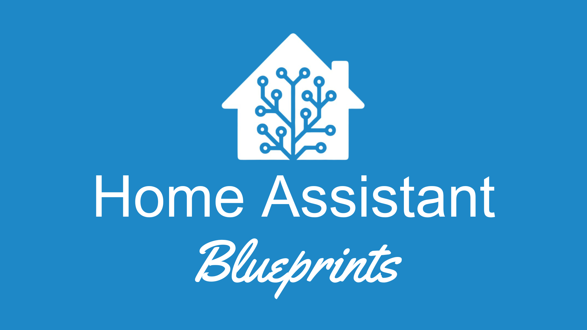

<div align="center">



<br/><br/>

# HA Blueprints

### Blueprints für Home Assistant

Eine Sammlung von Blueprints für [Home Assistant](https://www.home-assistant.io),
die sich jeweils mit einem Klick importieren lassen.

<p>
  
  
  
</p>

**[Übersicht](#-übersicht)** ·
**[Blueprints](#-blueprints)** ·
**[Installation](#-installation)** ·
**[Struktur](#-struktur)**

</div>

<br/><br/>

##  Übersicht

Dieses Repository bündelt meine Blueprints für **Home Assistant** an einem Ort.

Jeder Blueprint hat einen eigenen Ordner mit der Blueprint-Datei, einer README mit
Konzept, benötigten Helfern und Schritt-für-Schritt-Einrichtung sowie den zugehörigen
Beispiel-Automationen.

<br/><br/>

##  Blueprints

| **Blueprint** | **Beschreibung** | **Typ** | **Version** | **Import** |
| :--- | :--- | :---: | :---: | :---: |
| [**Heizlogik mit Override**](heizlogik-mit-override) | Manuell freundliche Heizungssteuerung pro Raum mit Heiz-Saison, Override, Urlaub, optionalem Zeitplan und Fensterkontakt. | Automation | 1.1.0 | [](https://my.home-assistant.io/redirect/blueprint_import/?blueprint_url=https%3A%2F%2Fgithub.com%2FxXJimnyCricketXx%2Fha-blueprints%2Fblob%2Fmain%2Fheizlogik-mit-override%2Fheizlogik_mit_override.yaml) |

<br/><br/>

##  Installation

**Per Klick:** Den *Import*-Badge des gewünschten Blueprints in der Tabelle oben anklicken.
Home Assistant öffnet sich direkt mit dem Import-Dialog.

**Manuell:**

1. In Home Assistant **Einstellungen → Automationen & Szenen → Blueprints** öffnen.
2. **Blueprint importieren** wählen.
3. Die GitHub-URL der Blueprint-Datei einfügen, z. B.:

   ```text
   https://github.com/xXJimnyCricketXx/ha-blueprints/blob/main/heizlogik-mit-override/heizlogik_mit_override.yaml
   ```

**Updates:** Unter **Blueprints** beim jeweiligen Blueprint das Drei-Punkte-Menü öffnen
und **Blueprint erneut importieren** wählen. Bestehende Automationen übernehmen die
neue Version automatisch.

> [!NOTE]
> Vor einem Update lohnt ein Blick in die Roadmap der jeweiligen Blueprint-Dokumentation.
> Dort steht, was sich geändert hat.

<br/><br/>

##  Struktur

```text
ha-blueprints/
├── heizlogik-mit-override/           # ein Ordner pro Blueprint
│   ├── heizlogik_mit_override.yaml   # Blueprint-Datei (Import-URL)
│   ├── README.md                     # Dokumentation
│   ├── examples/                     # Beispiel-Automationen
│   └── assets/                       # Screenshots (optional)
├── assets/
│   └── readme/                       # Bilder für diese README
├── LICENSE
└── README.md
```

Ordner und Dateinamen eines Blueprints bleiben nach der Veröffentlichung unverändert.
Home Assistant merkt sich beim Import die URL, und **Blueprint erneut importieren**
holt Updates nur von dort.

<br/><br/>

##  Lizenz

Alle Blueprints in diesem Repository stehen unter der **MIT License**.

Siehe [`LICENSE`](LICENSE) für Details.

<br/><br/>

---

<br>

<div align="center">


<br>

<a href="https://github.com/xXJimnyCricketXx">
  
</a>
<a href="https://cricketcode.de">
  
</a>

</div>
